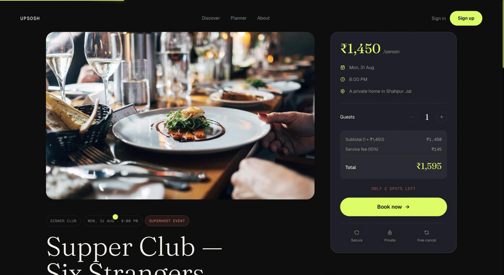
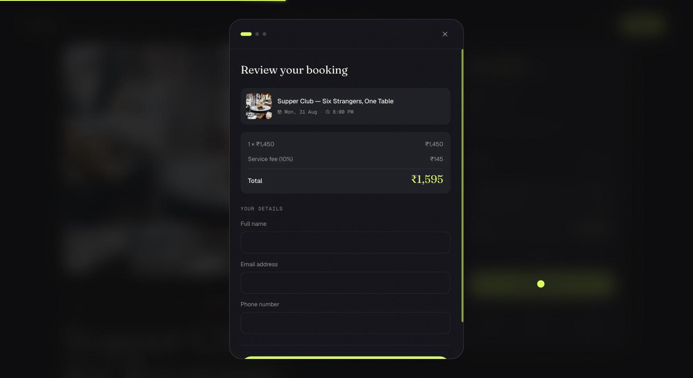
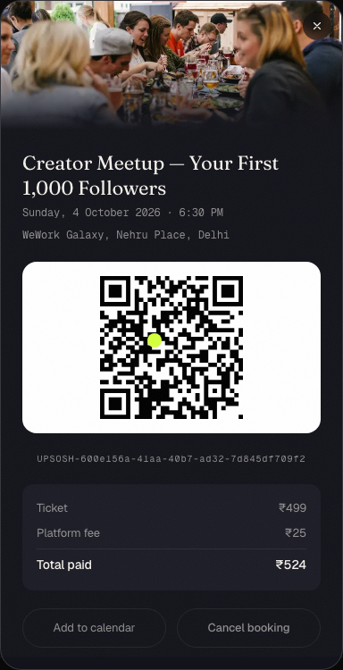

# upSosh

[](https://github.com/ParrvLuthra22/upSosh/actions/workflows/ci.yml)

**India's curated micro-events platform.** Run clubs, supper clubs, book circles, workshops — hosts list an event, attendees browse and pay through Razorpay, and a scannable QR ticket lands in their inbox. Everything — pricing, seat allocation, payment verification — is decided on the server, never the client.

**Live:** [upsosh.app](https://upsosh.app)

---

## Screenshots

<table>
<tr>
<td align="center"><b>Discover</b></td>
<td align="center"><b>Event detail</b></td>
</tr>
<tr>
<td></td>
<td></td>
</tr>
<tr>
<td align="center"><b>Razorpay checkout</b></td>
<td align="center"><b>Confirmed QR ticket</b></td>
</tr>
<tr>
<td></td>
<td></td>
</tr>
</table>

---

## What it does

An attendee opens `/discover`, finds an event — a Sunday run club, a candlelit supper circle, a weekend workshop — and books it in three taps. Free events confirm instantly. Paid events go through a real Razorpay checkout: the server creates the order at a price it computed from the database (not from anything the client sent), Razorpay captures the money, and the server independently verifies the payment before marking the booking confirmed. A QR ticket is emailed via Resend and lives under `/my-bookings`.

Hosts apply for verification through the app. Once approved they get a dashboard with real booking counts, revenue, and attendee data for every event they've created. They upload event images to Cloudinary, and can use the AI Planner (OpenRouter → Gemini Flash) to brainstorm and draft event listings. Google sign-in is supported as an alternative to email/password.

Everything consequential — session validity, payment amount, resource ownership — is asserted by the backend, not trusted from the frontend.

---

## Traction

| Metric | Count |
|---|---|
| Events hosted | — |
| Bookings completed | — |
| Hosts verified | — |
| Cities active | — |
| Gross GMV (INR) | — |

---

## Stack

| Layer | Technology | Why |
|---|---|---|
| Frontend | Next.js 14 (App Router), React 18, TypeScript | App Router for file-based routing and React Server Components; TypeScript because a booking/payment app is exactly where you don't want to typo into a bug |
| Styling | Tailwind CSS | Fast to build a consistent dark-mode design system without a custom CSS architecture |
| State | Zustand | Smaller and less ceremony than Redux — auth store, booking flow store, discover filters. Each persisted to `localStorage` through the Zustand persist middleware |
| Animation | Framer Motion | Page transitions, modals, skeleton loaders, the intro screen |
| Backend | Express 4, TypeScript | REST API with no unusual routing needs. Express is the boring, well-understood choice, and boring is correct for a payment path |
| ORM | Prisma 6 | Generated types keep database schema and TypeScript types in sync; migrations are checked into git |
| Database | PostgreSQL 16 (Neon) | Relational integrity matters here — a booking, its event, and its payment status need real foreign keys and transactions |
| Auth | JWT (`jsonwebtoken`) + bcrypt, httpOnly cookie | No session store; the cookie is httpOnly so XSS can't read it. Google ID-token sign-in (`google-auth-library`) supported as an alternative |
| Payments | Razorpay | The processor with the most direct India/UPI support |
| Email | Resend | Transactional emails — booking confirmations and password-reset links |
| Images | Cloudinary | Upload + transform + CDN in one service, so the backend doesn't need its own image pipeline |
| AI planner | OpenRouter (`google/gemini-2.0-flash-001`) | One API surface for LLM calls without coupling to a single provider's SDK |
| Testing | Jest + Supertest (backend), Playwright (E2E) | Supertest drives the actual Express app against a real Postgres — no mocked HTTP layer |
| Hosting | Render (backend), Vercel (frontend) | Render for a long-running Node process; Vercel as the reference host for Next.js |

---

## Architecture

```
┌──────────────┐        /api/*         ┌──────────────┐        Prisma        ┌──────────────┐
│   Next.js    │ ───────────────────▶  │   Express    │ ───────────────────▶ │  PostgreSQL  │
│  (Vercel)    │ ◀─────────────────── │  (Render)    │ ◀─────────────────── │   (Neon)     │
└──────────────┘   httpOnly cookie     └──────┬───────┘                      └──────────────┘
                                               │
                       ┌───────────────────────┼───────────────────────┬──────────────────────┐
                       ▼                       ▼                       ▼                       ▼
                ┌─────────────┐        ┌─────────────┐        ┌─────────────┐        ┌─────────────┐
                │  Razorpay   │        │ Cloudinary  │        │   Resend    │        │ OpenRouter  │
                │  payments   │        │   images    │        │   email     │        │  AI planner │
                └─────────────┘        └─────────────┘        └─────────────┘        └─────────────┘
```

**Rewrite proxy.** Every `/api/*` call from the Next.js frontend goes through `next.config.js`'s rewrite → same-origin → the backend. There is no direct cross-origin call. This is the only way the httpOnly session cookie — which is scoped to the frontend's origin — travels with every request. The `NEXT_PUBLIC_BACKEND_URL` env var is used only by the rewrite; nothing in client-side code ever builds a cross-origin URL.

**Auth.** `POST /api/auth/signin` (or `/signup`) checks the password with bcrypt, signs a JWT (`{ userId }`, 7-day expiry) into an httpOnly cookie. `middleware/auth.ts`'s `requireAuth` verifies the JWT and re-reads the user from the database every request (so a soft-deleted user's existing token stops working immediately). Google sign-in (`POST /api/auth/google`) verifies a Google-issued ID token, then issues the same JWT cookie.

**Payments** are the most technically involved part of the codebase — the full walkthrough is in its own section below.

---

## Features

### For attendees
- **Browse events** on `/discover` — filterable by category, city, date range, and price
- **Book in seconds** — guest details, Razorpay checkout (UPI, cards, net banking), instant confirmation
- **QR ticket** — scannable ticket with booking ID, event details, payment breakdown; lives at `/my-bookings`
- **Cancel bookings** — two-tap confirmation; a real Razorpay refund fires on cancellation of a paid booking
- **Booking confirmation email** — sent via Resend on every confirmed booking
- **Password reset** — token-based flow, email delivered via Resend

### For hosts
- **Host dashboard** (`/host/dashboard`) — real booking counts, revenue, and attendee lists per event
- **Create & manage events** — title, description, date/time, venue, capacity, price, category, image
- **Image upload** — to Cloudinary; auto-cropped and CDN-served
- **AI event planner** (`/planner`) — paste a brief, get a structured event plan (title, description, format, suggested price, logistics) from Gemini Flash via OpenRouter
- **Verification** — apply through the app; approved hosts get a verified badge

### For admins
- **Host approval** — review pending host applications at `/admin`
- **Payment oversight** — view booking and payment status across all events

---

## Data model

The core tables and their relationships:

```
User ──┬── owns ──▶ HostApplication
       ├── has ───▶ Booking ──▶ Event ──▶ Host
       └── receives Notification

Payment is embedded on Booking:
  Booking { paymentStatus, paymentMethod, razorpayOrderId, razorpayPaymentId, qrCode, ... }
```

Key Prisma enums:

| Enum | Values |
|---|---|
| `BookingStatus` | `pending`, `confirmed`, `cancelled`, `refunded`, `expired` |
| `PaymentStatus` | `unpaid`, `paid`, `failed`, `refunded` |
| `PaymentMethod` | `razorpay`, `upi`, `free` |
| `EventStatus` | `draft`, `live`, `full`, `past`, `cancelled` |
| `Role` | `user`, `host`, `admin` |
| `HostStatus` | `none`, `pending`, `verified` |

`BookingStatus.expired` catches bookings left unpaid for more than 15 minutes — a background sweep in `backend/src/index.ts` sets them on a schedule, so the UI never shows a ghost booking as "pending" indefinitely.

---

## Getting started

### Prerequisites

- **Node 20+** (developed on 22) — `node -v`
- **npm 10+** — ships with Node 20+
- **Docker** for local Postgres (or a native Postgres 14+ install)

The following are optional — the app runs without them, but the corresponding feature is disabled: a Razorpay test account (payments), a Resend key (email), Cloudinary credentials (uploads), an OpenRouter key (the AI planner), a Google OAuth Client ID (Google sign-in).

### Steps

Verified by deleting `node_modules`, dropping the local database, and running this exact sequence on a clean checkout:

```bash
# 1. Clone and install
git clone https://github.com/ParrvLuthra22/upSosh.git upSosh
cd upSosh
npm install           # installs both workspaces, runs `prisma generate`

# 2. Start Postgres
docker compose up -d  # Postgres 16 on :5432, user/pass/db: postgres/postgres/upsosh

# 3. Env files, migrate, seed — one command
npm run setup
```

`npm run setup` copies `backend/.env.example` → `backend/.env` and `frontend/.env.example` → `frontend/.env` (never overwriting an existing file), applies every pending Prisma migration, and seeds 3 users, 3 hosts, and 10 events dated relative to today. It prints this at the end:

```
  LOG IN WITH ANY OF THESE (password is the same for all three):

    admin@upsosh.test     upsosh123
      Admin — can reach /admin/payments and the host-approval endpoints
    host@upsosh.test      upsosh123
      Host — owns the seeded events, can create more
    user@upsosh.test      upsosh123
      Attendee — use this one to test the booking flow
```

```bash
# 4. Run it
npm run dev
```

| Service | URL |
|---|---|
| Frontend | http://localhost:3000 |
| API | http://localhost:4000 |
| Health check | http://localhost:4000/health |

**Port 5432 already taken?** Postgres will accept the connection and reject the password — it shows as `authentication failed`, not `can't connect`. Pick a different port:

```bash
POSTGRES_PORT=5433 docker compose up -d
POSTGRES_PORT=5433 npm run setup
```

### Testing a payment

Sign in as `user@upsosh.test`, open any **paid** event from `/discover`, and book it. In the Razorpay test checkout:

| Field | Value |
|---|---|
| Card number | `5267 3181 8797 5449` (Mastercard — Razorpay's documented India-domestic test card) |
| Expiry | any future date, e.g. `12/30` |
| CVV | any 3 digits |
| OTP | any 6 digits — test mode accepts anything |

> **Use this card, not `4111 1111 1111 1111`.** Razorpay's BIN lookup flags that number as an internationally-issued test card; this project's test account has international cards disabled. `5267 3181 8797 5449` is the exact card used in `frontend/tests/booking-flow.spec.ts`.

After paying, check `/my-bookings` — the booking should show *confirmed* with a scannable QR ticket.

---

## Environment variables

`backend/.env` holds every secret. `frontend/.env` holds nothing secret — Next.js inlines every `NEXT_PUBLIC_*` variable into the browser bundle at build time, so anything there is public by definition.

### Backend (`backend/.env`)

| Variable | Required | Purpose | Where to get it |
|---|---|---|---|
| `DATABASE_URL` | **Yes** | Postgres connection string | Local Docker, or your host's provisioned database |
| `JWT_SECRET` | **Yes** | Signs session JWTs | Any random string locally; a real secret before deploying |
| `PORT` | No (default `4000`) | API port | — |
| `FRONTEND_URL` | **Yes** | Added to the CORS allow-list | Your frontend's origin |
| `RAZORPAY_KEY_ID` / `RAZORPAY_KEY_SECRET` | For payments | Order creation + signature verification | [dashboard.razorpay.com](https://dashboard.razorpay.com) → Settings → API Keys |
| `RAZORPAY_WEBHOOK_SECRET` | For webhooks | `POST /api/payments/webhook` fails closed without this | Razorpay dashboard → Settings → Webhooks → Secret |
| `GOOGLE_CLIENT_ID` | For Google sign-in | Verifies ID token audience | [console.cloud.google.com](https://console.cloud.google.com) → OAuth client ID (Web application) |
| `OPENROUTER_API_KEY` | For `/planner` | AI event planner | [openrouter.ai](https://openrouter.ai) |
| `RESEND_API_KEY` | For email | Booking confirmations, password resets | [resend.com](https://resend.com) |
| `CLOUDINARY_CLOUD_NAME` / `CLOUDINARY_API_KEY` / `CLOUDINARY_API_SECRET` | For uploads | Event images, host avatars | [cloudinary.com](https://cloudinary.com) |

### Frontend (`frontend/.env`)

| Variable | Required | Purpose | Notes |
|---|---|---|---|
| `NEXT_PUBLIC_BACKEND_URL` | **Yes** | Origin the rewrite proxy sends `/api/*` to | `http://localhost:4000` locally |
| `NEXT_PUBLIC_RAZORPAY_KEY_ID` | **Yes** | Opens the Razorpay checkout widget | Without this, paid bookings fail loudly (not silently) — nobody can complete a paid booking |
| `NEXT_PUBLIC_FRONTEND_URL` | **Yes** | This app's own public origin | Used for absolute links and Playwright's `baseURL` |
| `NEXT_PUBLIC_GOOGLE_CLIENT_ID` | No | Renders the "Continue with Google" button | Must match backend's `GOOGLE_CLIENT_ID`. Unset → button doesn't render, no broken UI |
| `NEXT_PUBLIC_API_URL` | No | Absolute API base for non-rewrite call sites | Leave empty locally |
| `NEXT_PUBLIC_APPLE_CLIENT_ID` | No | — | Not implemented; placeholder only |

---

## Project structure

```
upSosh/
├── backend/
│   ├── prisma/
│   │   ├── schema.prisma        User · Host · Event · Booking · HostApplication · Upload · Notification
│   │   └── migrations/          one directory per migration, applied in order by `prisma migrate deploy`
│   ├── src/
│   │   ├── routes/
│   │   │   ├── auth.ts          signup · signin · signout · google · forgot-password · reset-password · refresh
│   │   │   ├── users.ts         PATCH /me · PATCH /me/password · POST /me/avatar · DELETE /me · GET /:username
│   │   │   ├── events.ts        list · get · create · update · delete · host events
│   │   │   ├── hosts.ts         get host profile · host-apply · admin approval
│   │   │   ├── bookings.ts      create · list mine · get · cancel (+ real Razorpay refund)
│   │   │   ├── payments.ts      create-order · verify · webhook
│   │   │   ├── notifications.ts list · mark-read · mark-all-read
│   │   │   ├── ai.ts            POST /api/ai/plan — OpenRouter event planner
│   │   │   └── uploads.ts       POST /api/uploads — Cloudinary image upload
│   │   ├── middleware/
│   │   │   ├── auth.ts          requireAuth · requireRole · requireHostStatus
│   │   │   └── validate.ts      Zod body validation middleware
│   │   ├── lib/
│   │   │   ├── prisma.ts        singleton Prisma client
│   │   │   ├── email.ts         Resend — sendBookingConfirmation · sendPasswordResetEmail
│   │   │   ├── cloudinary.ts    upload helper + imageUpload multer middleware
│   │   │   ├── notify.ts        in-app notification helper
│   │   │   └── schemas.ts       Zod schemas shared across routes
│   │   ├── scripts/seed.ts      `npm run db:seed` — 3 users, 3 hosts, 10 events
│   │   └── index.ts             app wiring: helmet, CORS allow-list, rate limiters, route mounts, expired-booking sweep
│   └── tests/
│       ├── auth.test.ts         password hashing, generic error on wrong password
│       ├── authorization.test.ts IDOR checks — bookings, payment orders, events, host approval
│       ├── booking.test.ts      capacity, concurrency (N+1 last seat), refund-on-cancel
│       └── payments.test.ts     client-controlled-amount regression, signature-replay regression
├── frontend/
│   ├── app/                     Next.js App Router — one directory per route
│   │   ├── page.tsx             Homepage
│   │   ├── discover/            Event discovery grid with filters
│   │   ├── events/[slug]/       Event detail page — map embed, share bar, booking CTA
│   │   ├── my-bookings/         Attendee booking list — QR ticket modal, cancel flow
│   │   ├── profile/             Account settings — name, bio, avatar upload, city
│   │   ├── settings/            Security settings — change password
│   │   ├── planner/             AI event planner (OpenRouter)
│   │   ├── host/dashboard/      Host event management and stats
│   │   ├── host/events/new/     Create new event with image upload
│   │   ├── become-a-host/       Host application form
│   │   ├── forgot-password/     Request password reset email
│   │   ├── reset-password/      Consume reset token, set new password
│   │   └── (auth)/              signin · signup · onboarding
│   ├── components/
│   │   ├── ProtectedRoute.tsx   Auth gate — reads Zustand store; shows page immediately if user in store
│   │   ├── IntroScreen.tsx      Premium intro animation shown once per browser session
│   │   ├── Nav.tsx              Top navigation — adapts to auth state
│   │   └── ...                  BookingFlow, GlobalHeader, GoogleSignInButton, skeletons, ...
│   ├── lib/
│   │   ├── stores/
│   │   │   ├── auth.ts          Zustand auth store with `hydrated` flag; persisted to localStorage
│   │   │   ├── booking.ts       Booking flow state
│   │   │   └── discover.ts      Discover page filters
│   │   ├── api.ts               Typed fetch wrapper — always same-origin through the rewrite proxy
│   │   └── motion.ts            Animation system constants
│   └── tests/
│       └── booking-flow.spec.ts  Playwright E2E: signup → discover → book → Razorpay checkout → QR ticket
├── scripts/setup.mjs            `npm run setup` — env files + migrate + seed in one command
├── docker-compose.yml           Local Postgres 16
├── railway.toml                 Legacy Railway config — the backend runs on Render now; Render does not read this file
├── SECURITY.md                  Two real payment-path vulnerabilities, their exploits, and the regression tests
└── FIXPLAN.md                   Phase-by-phase fix log anchored to file:line
```

---

## Payment flow

The part of this codebase where getting the details wrong means someone pays the wrong amount, or doesn't pay and gets confirmed anyway, or pays once and gets confirmed twice. Full code in `backend/src/routes/payments.ts` and `backend/src/routes/bookings.ts`.

### 1 — Booking creation (`POST /api/bookings`)

The client sends `eventId` and guest details — nothing about price. The server looks up the event, computes `ticketPrice + platformFee = totalAmount` itself, and creates a `Booking` row with `paymentStatus: 'unpaid'`. The amount the client will eventually be charged is decided here, from the database, before any payment has happened. A free event confirms and reserves its seat in this same step.

### 2 — Order creation (`POST /api/payments/create-order`)

For a paid event, the frontend calls this with only a `bookingId`. The handler re-fetches the booking, confirms the requesting user owns it, and computes `amountInPaise = Math.round(booking.totalAmount * 100)` from the database row — never from the request body. It creates a Razorpay order for that exact amount and immediately writes `order.id` onto `booking.razorpayOrderId`, binding this specific order to this specific booking before payment.

### 3 — Checkout

The frontend opens Razorpay's hosted checkout with the returned `orderId`, `amount`, and `key`. Razorpay's SDK calls back with `razorpay_order_id`, `razorpay_payment_id`, and `razorpay_signature`.

### 4 — Verification (`POST /api/payments/verify`)

Three checks, in order:

1. **Signature.** `HMAC-SHA256(order_id + '|' + payment_id, RAZORPAY_KEY_SECRET)` must match `razorpay_signature`, compared with `crypto.timingSafeEqual` (not `===`, which short-circuits on the first differing byte — a timing oracle).
2. **Binding.** `razorpay_order_id` must equal `booking.razorpayOrderId` written in step 2. A valid signature only proves *some* real payment happened on the account — the binding check is what ties it to this specific booking.
3. **State.** `paymentStatus` must currently be `'unpaid'`, enforced by a conditional `updateMany` (`WHERE paymentStatus = 'unpaid'`) — the WHERE clause is what makes two concurrent verification requests resolve to exactly one write, not a race.

Only after all three pass does the booking flip to `status: 'confirmed'`, the event's `attendees` count increment, and a confirmation email + in-app notification fire.

### 5 — Webhook (`POST /api/payments/webhook`)

Razorpay calls this server-to-server for `payment.captured`, `payment.failed`, and `refund.processed`, independent of whether the client's browser completed `/verify`. Mounted with `express.raw()` ahead of the global JSON parser so the handler can verify Razorpay's signature against the *exact bytes received* — re-serializing a parsed object doesn't reliably reproduce the original bytes. An unset `RAZORPAY_WEBHOOK_SECRET` fails every delivery closed (returns 500, verifies nothing) rather than silently skipping verification.

### 6 — Network-drop recovery

If the network drops after Razorpay captures but before `/verify` completes, the booking stays `unpaid` even though real money moved. The `payment.captured` webhook handler is the recovery path: it runs the same `WHERE paymentStatus = 'unpaid'` conditional update against `razorpayOrderId`. Whichever of `/verify` or the webhook arrives first does the work; the second is a guaranteed no-op.

Two real vulnerabilities in this flow (client-controlled amount, cross-booking signature replay) are fully narrated with their exploits and regression tests in **[SECURITY.md](./SECURITY.md)**.

---

## Security

- **Passwords** are hashed with bcrypt at cost factor 12. A Google-only account has `User.password: null` — no fake password, no hash to crack.
- **Sessions** are a JWT in an httpOnly cookie, never in `localStorage`. The auth store on the frontend explicitly purges any credential material a previous version of the app left in `localStorage`, on every load.
- **Password reset tokens** are generated with `crypto.randomBytes(32)`, emailed to the user, and stored server-side as a SHA-256 hash with an expiry. A leaked database row alone isn't a usable reset token.
- **Ownership checks.** Every `:id` endpoint that reads or mutates a resource re-checks that the authenticated user actually owns it — before returning a booking, before creating a payment order, before updating an event. Guarded by `backend/tests/authorization.test.ts`.
- **Route protection** is middleware, not a per-handler check: `requireAuth`, `requireRole`, `requireHostStatus` in `backend/src/middleware/auth.ts`.
- **Rate limiting** is two-tiered: 100 requests / 15 minutes generally, 10 / 15 minutes on `/api/auth/*` specifically — credential-stuffing attempts get throttled far harder than normal browsing traffic.
- **CORS** is an explicit allow-list (`www.upsosh.app`, `upsosh.app`, `localhost:3000`, plus `FRONTEND_URL`), not a wildcard.
- **Input validation** — every mutating route validates its request body through a Zod schema in `middleware/validate.ts` before the handler runs.

---

## Testing

```bash
# Backend — 16 Jest/Supertest integration tests, against a real Postgres
cd backend && npm test

# Frontend — one real Playwright E2E test
cd frontend && npm run test:e2e
```

**Backend (`backend/tests/`):**

| File | What it covers |
|---|---|
| `auth.test.ts` | Password hashing on signup; generic error on wrong password (no email enumeration) |
| `authorization.test.ts` | IDOR across bookings, payment orders, event creation, admin host-approval |
| `booking.test.ts` | Capacity enforcement; concurrency test — N+1 simultaneous requests for the last seat, exactly one succeeds; refund-on-cancel |
| `payments.test.ts` | Client-controlled-amount regression; signature-replay regression (both described in `SECURITY.md`) |

All 16 run against a real database via Supertest driving the actual Express app. Nothing is mocked at the HTTP layer.

**Frontend (`frontend/tests/booking-flow.spec.ts`):** one test — signup, browse to a paid event, book it, pay with a real Razorpay test-mode card including the 3-D Secure OTP step, land on the in-modal confirmation, and see the confirmed ticket in `/my-bookings`. Slow (real network through Razorpay's actual checkout), needs real `RAZORPAY_TEST_KEY_ID`/`RAZORPAY_TEST_KEY_SECRET` credentials. Also runs in CI (`.github/workflows/ci.yml`'s `e2e` job) — a real Razorpay test-mode payment on every push and PR.

**What's honestly not covered:** no frontend component/unit tests. No test covers the AI planner, image uploads, or the admin host-approval UI beyond the one authorization check above. No load testing exists.

---

## Deployment

### Backend → Render

The backend is a single Render **Web Service** (Node). Its settings live in Render's dashboard — there is no `render.yaml` in this repo.

| Setting | Value |
|---|---|
| Root / working dir | repo root (commands `cd` into `backend/`) |
| Build command | `cd backend && npm ci && npm run build` |
| **Start command** | `cd backend && npm run start` |
| **Health check path** | `/health` |

`npm run start` runs `prisma migrate deploy` before starting the server (`backend/package.json`), so every deploy applies pending migrations to the service's database. Read [Releasing](#releasing) before merging a migration.

**Environment variables to set on the Render service** (full table under [Environment variables](#backend-backendenv)):

| Variable | Notes |
|---|---|
| `NODE_ENV` | Must be exactly `production`. It turns on `Secure; SameSite=None` cookies and hides stack traces. |
| `DATABASE_URL` | The production Postgres connection string. |
| `JWT_SECRET` | Long random string (32+ chars). Never the example value. |
| `FRONTEND_URL` | The Vercel site's origin, e.g. `https://www.upsosh.app` (CORS allow-list). |
| `RAZORPAY_KEY_ID`, `RAZORPAY_KEY_SECRET` | Live keys (`rzp_live_…`) only when you are ready for real money. |
| **`RAZORPAY_WEBHOOK_SECRET`** | **Required.** Razorpay dashboard → Settings → Webhooks → your webhook → Secret. Without it `POST /api/payments/webhook` returns 500 and verifies nothing, so a payment whose browser never reached `/verify` is never confirmed. Webhook URL: `https://<your-service>.onrender.com/api/payments/webhook`, events `payment.captured`, `payment.failed`, `refund.processed`. |
| `RESEND_API_KEY` | Without it, confirmation and reset emails are silently skipped. |
| `GOOGLE_CLIENT_ID`, `OPENROUTER_API_KEY`, `CLOUDINARY_CLOUD_NAME` / `CLOUDINARY_API_KEY` / `CLOUDINARY_API_SECRET` | Optional; the matching feature returns 503 or hides itself when unset. |

`railway.toml` is left in the repo from the earlier Railway deployment. Render does not read it.

### Frontend → Vercel

Root directory: `frontend`. Build: `npm run build`. Output: `.next`.

Set `NEXT_PUBLIC_BACKEND_URL`, `NEXT_PUBLIC_RAZORPAY_KEY_ID`, `NEXT_PUBLIC_FRONTEND_URL`, and (optionally) `NEXT_PUBLIC_GOOGLE_CLIENT_ID` in the project's environment variables. These are inlined at build time — changing one requires a new deploy, not just a restart.

### Notes

- The backend's `@types/*` packages are in `dependencies`, not `devDependencies`. Render doesn't install `devDependencies` in production; if TypeScript types are in `devDependencies`, `tsc` fails at build time with "Cannot find module '@types/...'".
- Prisma generates its client at `postinstall` and again at `build`. Both are needed: `postinstall` covers `npm ci` on the host; `build` ensures the generated types match the schema at compile time.

---

## Releasing

- **Everything goes through a pull request** into `main` (use the PR template). CI must be green. Merging to `main` deploys; there is no separate release step.
- **Never run `prisma migrate`, `npm run seed`, or `make-admin.js` against the production database from a laptop.** `backend/.env` can point at a real database; always pass an explicit local `DATABASE_URL` for local runs. Production migrations run on Render at deploy time via `npm run start`. The seed script refuses non-local databases and production unless you override it on purpose.
- **Take a database backup before merging any migration** (a provider snapshot, or `pg_dump`), and write down how you would roll back: migrations here are forward-only, so rollback means restoring the backup or shipping a follow-up migration.
- Prefer additive migrations (new nullable column, or a column with a default). Be careful with drops, type changes, and enum casts: they can fail on existing rows and a failed migration stops the service from starting.
- After a deploy, check the Render logs for the migration, `GET /health`, and one real booking in test mode.

---

## Scope — what's deliberately not built

| Feature | Why not built |
|---|---|
| **Host payouts** | Money flows in; nothing sends it back out. A real payout system needs KYC on every host (RBI won't let a platform disburse to an unverified account), a settlement ledger separating `platformFee` from host net, and its own failure/retry handling. Hosts are paid manually for now. |
| **Real-time updates** | No WebSockets or SSE. Attendee counts and dashboards are poll/refetch-on-navigation, not push. |
| **Reviews and ratings** | No `Review` or `Rating` model in `schema.prisma`. Host ratings in the UI are display data, not a live system. |
| **Multi-currency** | `currency: 'INR'` is hardcoded in `payments.ts`. Every price display uses `toLocaleString('en-IN')`. |
| **Chargebacks / disputes** | Refunds exist on cancellation; there's no flow for a dispute Razorpay flags or a refund without cancelling. |
| **Phone verification** | `guestPhone` is collected on every booking but never verified via SMS/OTP. |
| **Apple sign-in** | Google sign-in exists. `NEXT_PUBLIC_APPLE_CLIENT_ID` is a placeholder with no component behind it. |

---

## Known limitations

- No structured logging — the backend logs to stdout with bare `console.*` calls, no request IDs, no log levels.
- The AI planner uses a single hardcoded OpenRouter model ID (`backend/src/routes/ai.ts`); if the model is deprecated upstream, the planner fails until the ID is updated in code.
- No CI-enforced database migration check — a migration can be merged without CI ever applying it against a real Postgres to confirm it runs cleanly.
- `AUDIT.md`, referenced by `FIXPLAN.md` as the original analysis document, isn't in this repo. `FIXPLAN.md` itself is the more useful day-to-day document — every task is anchored to a specific file and line, and each closed one has a written record of what actually changed.
